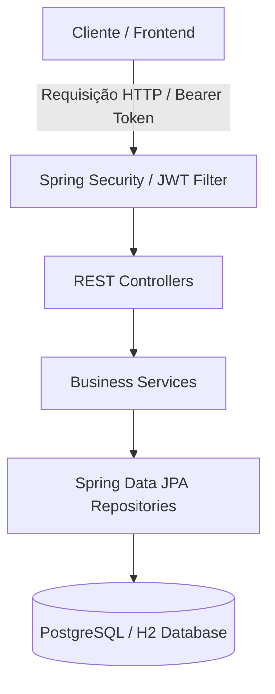

# 🚀 Jecatalog API

> Sistema corporativo de Catálogo de Produtos e Categorias desenvolvido com arquitetura em camadas em Java 21 e Spring Boot 3.x, focado em alta performance de consultas, segurança robusta com OAuth2/JWT e padrões rigorosos de testes automatizados.

---

## 🛠️ Decisões de Arquitetura e Engenharia

* **Problema Resolvido:** Implementação de API REST para gerenciamento de catálogo com mitigação rigorosa do problema de consulta JPA N+1 via otimização de mapeamentos e **DTO Projection**, garantindo alta eficiência no tráfego de dados relacionais.
* **Segurança:** Autenticação e autorização *stateless* baseada em tokens **JWT (JSON Web Token)** integrada com controle de acessos por perfis (**RBAC - Role-Based Access Control**) e criptografia via BCrypt.
* **Resiliência e Tratamento de Erros:** Tratamento global de exceções centralizado via `@ControllerAdvice`, retornando respostas padronizadas e descritivas para falhas de validação e regras de negócio.
* **Qualidade de Software (Testes):** Suíte estruturada cobrindo **Testes Unitários** (com JUnit 5 e Mockito isolando repositórios e serviços) e **Testes de Integração** (`ProductServiceIT` e `ProductResourceTests` validando o comportamento completo da API com Spring Boot Test).

---

## 📊 Arquitetura do Sistema (Visão Geral)

###✨ Próximos Passos

* **DEPLOY**: Preparar o `Dockerfile` para ambiente de produção

* **Testes Automatizados**: Implementar testes de API *Rest Assured* e cobertura *JaCoCo*