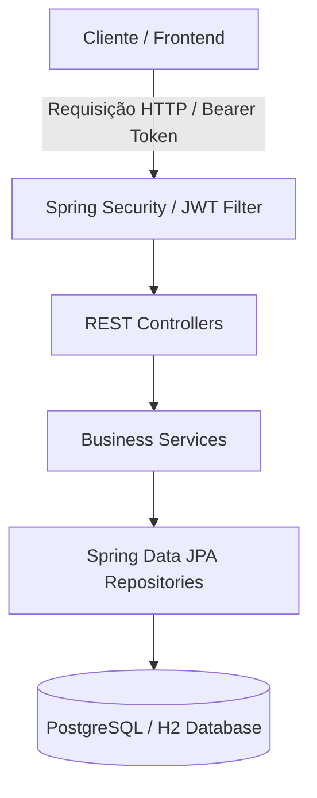

# JeCatalog - Java Spring Boot, AWS S3 Integration & Testing Architecture

<p align="center">
  
  
  
  
  
</p>

---

## 📌 Sobre o Projeto

O **JeCatalog** é uma aplicação backend RESTful desenvolvida com **Spring Boot** e **Java 21**, projetada sob os princípios de Clean Code, SOLID, testes automatizados e integração contínua com serviços de nuvem.

Este repositório documenta todo o ciclo de engenharia do sistema: desde a modelagem de domínio, autenticação JWT, suíte de testes unitários e de integração com relatório de cobertura **JaCoCo**, até a integração profissional de armazenamento de objetos no **Amazon S3**.

---

## 🛠️ Decisões de Arquitetura e Engenharia

* **Problema Resolvido:** Implementação de API REST para gerenciamento de catálogo com mitigação rigorosa do problema de consulta JPA N+1 via otimização de mapeamentos e **DTO Projection**, garantindo alta eficiência no tráfego de dados relacionais.
* **Segurança:** Autenticação e autorização *stateless* baseada em tokens **JWT (JSON Web Token)** integrada com controle de acessos por perfis (**RBAC - Role-Based Access Control**) e criptografia via BCrypt.
* **Resiliência e Tratamento de Erros:** Tratamento global de exceções centralizado via `@ControllerAdvice`, retornando respostas padronizadas e descritivas para falhas de validação e regras de negócio.
* **Qualidade de Software (Testes):** Suíte estruturada cobrindo **Testes Unitários** (com JUnit 5 e Mockito isolando repositórios e serviços) e **Testes de Integração** (`ProductServiceIT` e `ProductResourceTests` validando o comportamento completo da API com Spring Boot Test).

---

## 📊 Arquitetura do Sistema (Visão Geral)



## 🛠️ Tecnologias e Ferramentas Utilizadas

* **Linguagem & Framework:** Java 21 | Spring Boot (Data JPA, Web, Security, OAuth2/JWT)
* **Gerenciador de Dependências:** Apache Maven (Maven Wrapper)
* **Armazenamento de Arquivos em Nuvem:** AWS SDK S3 (`com.amazonaws:aws-java-sdk-s3`)
* **Testes & Qualidade Code Coverage:** JUnit 5, Mockito, Spring Boot Test, H2 Database & **JaCoCo Plugin**
* **Utilitários:** Apache Commons IO (`commons-io`) para manipulação segura de caminhos e extensões
* **Bancos de Dados:** H2 Database (Testes/Dev) | PostgreSQL (Produção)
* **IDE & Ambiente:** Spring Tool Suite 4 (STS) | Windows 11
* **Versionamento & Governança:** Git & GitHub (GitFlow Workflow)

---

## 🚀 Linha do Tempo e Evolução do Projeto

### 1. Suíte de Testes Automatizados e Qualidade (JaCoCo)
* **Testes Unitários:** Implementação de testes isolados da camada de serviço (`ProductServiceTests`, `CategoryServiceTests`) utilizando **Mockito** (`@Mock`, `@InjectMocks`) para simular o comportamento de repositórios sem dependência de banco de dados.
* **Testes de Integração:** Validação das regras de negócio atreladas à camada de dados utilizando `@DataJpaTest` e banco de dados H2 em memória.
* **Métricas de Cobertura (JaCoCo):** Configuração do plugin `jacoco-maven-plugin` no `pom.xml` para geração automática do relatório de cobertura de código (`target/site/jacoco/index.html`), garantindo alta confiabilidade nos fluxos da aplicação.
* **Próximo Passo Planejado:** Implementação dos **Testes de API / REST Integration** (testando os endpoints HTTP, validações de payload e retornos de status code com RestAssured / MockMvc).

### 2. Configuração do Ecossistema e Infraestrutura Cloud
* **Criação do Bucket & IAM:** Provisionamento do bucket `jecatalog-image` no Amazon S3 localizado na região `sa-east-1` (São Paulo) e conta IAM dedicada com acesso restrito via políticas de segurança.
* **Criptografia & Segurança:** Criptografia no lado do servidor (SSE-S3) e bloqueio de acesso público via painel AWS.
* **Injeção Segura de Credenciais:** Parametrização do arquivo `application.properties` utilizando a sintaxe `${VARIAVEL:default}`, impedindo o vazamento de chaves privadas (`AWS_KEY` e `AWS_SECRET`) no repositório.

### 3. Configuração e Testes Didáticos
* **Classe `S3Config`:** Mapeamento do `@Bean` `AmazonS3` injetando credenciais estáticas e configurando a região dinamicamente via `Regions.fromName(region)`.
* **Validação do Ambiente:** Mitigação de erros de *whitespace* em variáveis de ambiente (`InvalidBucketName`) e validação inicial de conectividade física com o S3.

### 4. Migração para Padrão Profissional RESTful (`MultipartFile`)
* **Serviço de Storage (`S3Service`):**
  * Manipulação de fluxo de dados (`InputStream`) e metadados (`ObjectMetadata`) do arquivo recebido na requisição HTTP.
  * Sanitização de extensões com `FilenameUtils.getExtension(...)` e geração de identificadores únicos no S3 utilizando concatenação com `Instant.now()`.
  * Retorno da URL pública (`URL`) do objeto gravado na nuvem.
* **Controlador REST (`ProductResource`):**
  * Disponibilização do endpoint `POST /products/image` aceitando `multipart/form-data` com parâmetro `file`.
  * Encapsulamento da resposta no DTO `UriDTO` contendo o link do recurso gerado no S3.
* **Tratamento de Exceções Global (`ResourceExceptionHandler`):**
  * Mapeamento centralizado de `AmazonServiceException` e `AmazonClientException` via `@ControllerAdvice`, retornando respostas HTTP padronizadas com a estrutura `StandardError`.

---

## ⚙️ Variáveis de Ambiente Necessárias

Para executar o projeto localmente com integração ativa ao S3, cadastre as seguintes variáveis na aba **Environment** das *Run Configurations* da sua IDE (STS/Eclipse/IntelliJ):

```properties
AWS_KEY=sua_access_key_id_aqui
AWS_SECRET=sua_secret_access_key_aqui
JECATALOG_BUCKET_NAME=jecatalog-image
JECATALOG_BUCKET_REGION=sa-east-1
APP_PROFILE=dev